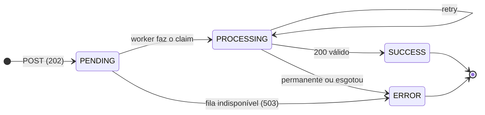
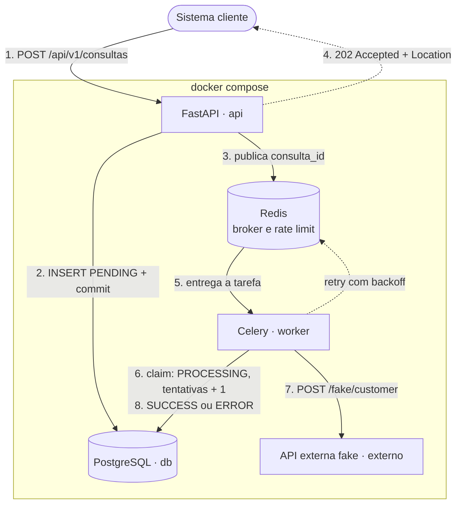
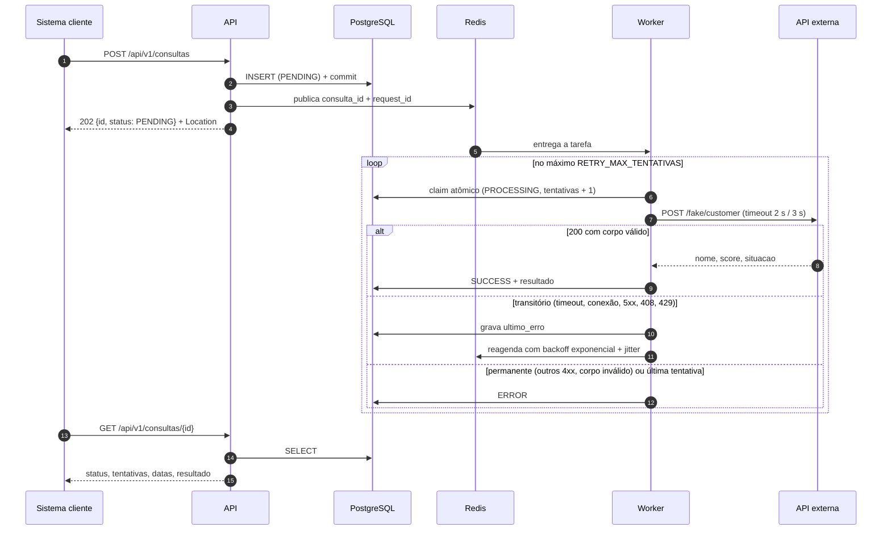

# customer_lookup — serviço de consultas assíncronas

Serviço intermediário que recebe pedidos de consulta de clientes (CPF/CNPJ), registra cada pedido, processa a consulta
a um serviço externo **fora da requisição HTTP** e guarda o resultado para consulta posterior. O serviço externo é
instável por natureza (lentidão, indisponibilidade, erros), então o foco está em **resiliência, rastreabilidade e
tratamento de falhas**.

- [Objetivo](#objetivo)
- [Arquitetura](#arquitetura)
- [Tecnologias](#tecnologias)
- [Como executar](#como-executar)
- [Exemplos da API](#exemplos-da-api)
- [API externa fake](#api-externa-fake)
- [Resiliência](#resiliência)
- [Logs](#logs)
- [Testes](#testes)
- [Decisões técnicas](#decisões-técnicas)
- [Débitos técnicos e evolução](#débitos-técnicos-e-evolução)

## Objetivo

1. Receber a solicitação em `POST /api/v1/consultas` e responder **na hora** (`202 Accepted`) com `id` e `PENDING`.
2. Processar de forma assíncrona: um worker consulta a API externa, com timeout, retry com backoff e limite de tentativas.
3. Guardar resultado ou erro e permitir acompanhar a consulta por `GET /api/v1/consultas/{id}` e pela listagem paginada.

Ciclo de vida da consulta:



`SUCCESS` e `ERROR` são terminais: nunca são sobrescritos. Durante o backoff a consulta continua `PROCESSING`, com
`tentativas` e `ultimo_erro` visíveis no `GET`.

## Arquitetura



O `POST` termina no passo 4: a chamada externa acontece depois, no worker. O fluxo completo, com retry:



Cinco serviços no `docker compose`: `api`, `worker`, `externo`, `db` e `redis`. `api`, `worker` e `externo` usam a
mesma imagem. A API externa fake roda em **outro container**, então a chamada atravessa a rede de verdade (timeout e
indisponibilidade são reais, e dá para parar o container durante a demonstração).

### Organização do código (hexagonal leve)

```text
src/customer_lookup/
├── main.py                 # create_app(): middlewares, handlers de erro, rotas
├── api/                    # camada HTTP: rotas, dependências (auth, rate limit), health
├── schemas/                # contratos Pydantic de entrada e saída
├── services/               # regras: criar consulta, processar consulta, política de retry, rate limit
├── ports.py                # portas (Protocol): ClienteExterno, PublicadorDeTarefas
├── adapters/               # implementações das portas: cliente httpx, publicador Celery
├── models/ + db/           # SQLAlchemy (tabela consultas) e sessão
├── worker/                 # app Celery e task fina que chama o service
├── core/                   # config, logging JSON, contexto de correlação, erros, validação de documento
└── fake_externo/           # API externa simulada (aplicação independente)
migrations/                 # Alembic
tests/                      # unit, integration, infra, e2e
```

- **Portas só onde há fronteira com o mundo externo** (rede e fila). O service não conhece httpx, Celery nem Redis;
  nos testes, as portas são substituídas por fakes simples.
- **Sem camada de repositório**: o `Session` do SQLAlchemy já é a unidade de trabalho. Uma abstração a mais não traria
  ganho para uma tabela.
- **A task do Celery é fina**: só monta as dependências e chama `services/processamento.py`. A regra de negócio fica
  testável sem broker.

## Tecnologias

| Tecnologia | Para quê |
|---|---|
| Python 3.14 + [uv](https://docs.astral.sh/uv/) | linguagem e gerenciador de dependências (lockfile `uv.lock`) |
| FastAPI + Pydantic v2 | API, validação e OpenAPI/Swagger |
| SQLAlchemy 2 (síncrono) + Alembic | ORM e migrações |
| PostgreSQL 17 | banco relacional (`resultado` em `JSONB`) |
| Celery + Redis | fila e worker, com retry agendado (`countdown`), `acks_late` e rate limit por task |
| httpx | cliente HTTP com timeouts separados de conexão e leitura |
| pydantic-settings | configuração por variáveis de ambiente |
| pytest, ruff, mypy (strict) | testes, lint/format e checagem de tipos |
| Docker + Docker Compose | execução local completa |
| GitHub Actions | CI (lint, tipos, testes e build da imagem) |

## Como executar

Pré-requisito: Docker com Compose v2.

```bash
docker compose up --build
```

Não é preciso criar `.env`: todas as variáveis têm padrão de desenvolvimento. O `.env.example` só documenta o que pode
ser sobrescrito.

| Endereço | O que é |
|---|---|
| <http://localhost:8000/docs> | Swagger (clique em **Authorize** e informe a chave abaixo) |
| <http://localhost:8000/health> | liveness |
| <http://localhost:8000/health/ready> | readiness (banco e Redis) |
| <http://localhost:9000/docs> | Swagger da API externa fake |

**Chave de API de desenvolvimento:** `chave-local-de-desenvolvimento`, no header `X-API-Key`. Ela existe apenas para
o ambiente local; fora dele, `API_KEY` deve vir de um cofre de segredos (o código não tem valor padrão e não sobe sem ela).

A API aplica as migrações (`alembic upgrade head`) antes de subir, e o worker só inicia depois de a API ficar saudável.
O banco e o Redis não têm porta publicada; a API e o fake ficam só em `127.0.0.1`.

### Variáveis de ambiente principais

| Variável | Padrão no compose | Efeito |
|---|---|---|
| `API_KEY` | `chave-local-de-desenvolvimento` | chave exigida no header `X-API-Key` |
| `RATE_LIMIT_POR_MINUTO` | `60` | limite de `POST` por chave por minuto |
| `DOCUMENTO_VALIDAR_DV` | `true` | valida os dígitos verificadores; `false` aceita números fictícios (só a forma é validada) |
| `RETRY_MAX_TENTATIVAS` | `5` | total de chamadas ao serviço externo por consulta |
| `RETRY_BASE_SEGUNDOS` / `RETRY_TETO_SEGUNDOS` | `1` / `10` | backoff (no código o padrão é 2 / 60; no compose é curto para a demonstração) |
| `EXTERNO_TIMEOUT_CONEXAO_S` / `EXTERNO_TIMEOUT_LEITURA_S` | `2` / `3` | timeouts da chamada externa |
| `WORKER_CONCORRENCIA` / `TAREFA_RATE_LIMIT` | `2` / `10/s` | proteção do serviço externo |
| `FAKE_FALHAS_ANTES_DE_RECUPERAR` / `FAKE_LENTIDAO_SEGUNDOS` | `2` / `5` | comportamento da API fake |

## Exemplos da API

Todos os endpoints `/api/v1/*` exigem `X-API-Key`. O documento aceita máscara (`529.982.247-25`) ou só dígitos.

### Criar uma consulta

```bash
curl -i -X POST http://localhost:8000/api/v1/consultas \
  -H "X-API-Key: chave-local-de-desenvolvimento" \
  -H "Content-Type: application/json" \
  -d '{"documento": "529.982.247-25", "tipo": "CPF"}'
```

```http
HTTP/1.1 202 Accepted
Location: /api/v1/consultas/7d0c2c8e-3f7a-4a51-9a39-0d6a1f0b9c11
X-Request-ID: 1b9d6bcd-bbfd-4b2d-9b5d-ab8dfbbd4bed

{"id": "7d0c2c8e-3f7a-4a51-9a39-0d6a1f0b9c11", "status": "PENDING"}
```

`202 Accepted` porque o pedido foi aceito, mas o processamento ainda não aconteceu. O `Location` aponta para onde
acompanhar o resultado.

### Consultar status e resultado

```bash
curl http://localhost:8000/api/v1/consultas/7d0c2c8e-3f7a-4a51-9a39-0d6a1f0b9c11 \
  -H "X-API-Key: chave-local-de-desenvolvimento"
```

```json
{
  "id": "7d0c2c8e-3f7a-4a51-9a39-0d6a1f0b9c11",
  "documento": "52998224725",
  "tipo": "CPF",
  "status": "SUCCESS",
  "tentativas": 1,
  "resultado": {"nome": "Cliente Teste", "score": 423, "situacao": "REGULAR"},
  "ultimo_erro": null,
  "criado_em": "2026-10-15T13:00:00.120000Z",
  "atualizado_em": "2026-10-15T13:00:00.410000Z",
  "processado_em": "2026-10-15T13:00:00.410000Z"
}
```

Uma consulta que falhou fica com `status: "ERROR"`, `resultado: null` e `ultimo_erro` com uma mensagem curta, por exemplo
`"serviço externo respondeu HTTP 500"`.

### Listar com paginação e filtros

```bash
curl "http://localhost:8000/api/v1/consultas?status=SUCCESS&documento=52998224725&page=1&page_size=20" \
  -H "X-API-Key: chave-local-de-desenvolvimento"
```

```json
{"items": [ ... ], "page": 1, "page_size": 20, "total": 1}
```

Filtros opcionais: `status` (`PENDING`, `PROCESSING`, `SUCCESS`, `ERROR`) e `documento`. `page_size` vai até 100.
A ordenação é a mais recente primeiro (`criado_em desc, id desc`, estável entre páginas).

### Erros

Todo erro segue o mesmo envelope:

```json
{
  "error": {
    "code": "INVALID_DOCUMENT",
    "message": "Documento informado é inválido.",
    "details": [{"field": "documento", "message": "dígitos verificadores inválidos"}]
  }
}
```

| HTTP | `code` | Quando |
|---|---|---|
| 401 | `UNAUTHORIZED` | `X-API-Key` ausente ou inválida |
| 404 | `CONSULTA_NOT_FOUND` | `id` não existe |
| 422 | `VALIDATION_ERROR` | payload ou parâmetro fora do contrato (campo faltando, `tipo` desconhecido, campo extra) |
| 422 | `INVALID_DOCUMENT` | CPF/CNPJ inválido (tamanho, caracteres ou dígitos verificadores) |
| 429 | `RATE_LIMITED` | limite de `POST` por minuto atingido (com header `Retry-After`) |
| 503 | `QUEUE_UNAVAILABLE` | a consulta foi registrada, mas a fila estava fora; ela vira `ERROR` e o `id` vem em `details` |
| 503 | `SERVICE_UNAVAILABLE` | readiness: banco ou Redis indisponível |
| 500 | `INTERNAL_ERROR` | erro inesperado; a resposta traz o `request_id` para achar o log |

## API externa fake

`POST /fake/customer` com `{"documento": "..."}` (só dígitos). O comportamento é escolhido pelo **último dígito do
documento**, o que deixa cada cenário reproduzível na demonstração:

| Último dígito | Comportamento | Desfecho da consulta |
|---|---|---|
| `0` | `500` sempre | `ERROR` depois de 5 tentativas |
| `1` | `503` nas 2 primeiras chamadas do documento, depois `200` | `SUCCESS` com 3 tentativas |
| `2` | responde em 5 s (acima do timeout de 3 s) nas 2 primeiras chamadas, depois `200` | `SUCCESS` com 3 tentativas |
| `3` | `404` cliente não encontrado | `ERROR` com 1 tentativa (erro permanente, sem retry) |
| demais | `200` `{"nome": "Cliente Teste", "score": ..., "situacao": "REGULAR"}` | `SUCCESS` com 1 tentativa |

Endpoints auxiliares: `GET /fake/chamadas` (quantas chamadas cada documento recebeu, para conferir com `tentativas`) e
`POST /fake/reset` (zera os contadores). Os contadores ficam em memória do processo.

### Documentos válidos para teste

Todos passam na validação dos dígitos verificadores:

| Cenário | CPF | CNPJ |
|---|---|---|
| `0`: 500, esgota as tentativas | `111.444.780-30` | `11.222.333/0018-20` |
| `1`: 503 e recupera no retry | `111.444.781-11` | `11.222.333/0001-81` |
| `2`: lentidão e recupera no retry | `111.444.790-02` | `11.222.333/0002-62` |
| `3`: 404, erro permanente | `111.444.783-83` | `11.222.333/0003-43` |
| sucesso | `529.982.247-25`, `390.533.452-64`, `390.533.447-05` | `11.222.333/0004-24`, `11.222.333/0005-05` |

Para testar com números fictícios, suba com `DOCUMENTO_VALIDAR_DV=false`:

```bash
DOCUMENTO_VALIDAR_DV=false docker compose up --build
```

## Resiliência

| Aspecto | Como foi tratado |
|---|---|
| Timeout | httpx com timeouts separados: conexão 2 s, leitura 3 s |
| Classificação de erros | **transitório** (timeout, erro de conexão, `5xx`, `408`, `429`) tem retry; **permanente** (demais `4xx`, `200` com corpo fora do contrato) vira `ERROR` imediato |
| Retry com limite | no máximo `RETRY_MAX_TENTATIVAS` (5) chamadas por consulta, contadas no banco; não existe retry infinito |
| Backoff com jitter | espera antes da tentativa n+1: `min(base · 2^(n-1), teto) · U(0,5; 1,5)`. O exponencial espaça a carga e o jitter evita que muitas consultas retentem no mesmo instante |
| Proteção do externo | concorrência baixa do worker (2) e rate limit da task (`10/s`), somados ao backoff |
| Sem bloqueio durante a espera | o retry é agendado no broker (`countdown`); o worker fica livre para outras consultas |
| Idempotência | antes de cada chamada, um `UPDATE ... RETURNING` atômico faz o *claim*: `PROCESSING` e `tentativas + 1`, só se a consulta não estiver terminal e ainda houver tentativas. Mensagem duplicada não passa do limite nem sobrescreve `SUCCESS`/`ERROR` |
| Nada fica órfão | a consulta é gravada (commit) **antes** de publicar na fila. Se a publicação falhar, ela vira `ERROR` e a API responde `503 QUEUE_UNAVAILABLE` com o `id` |
| Perda de worker | `acks_late`: a mensagem só é confirmada depois de processada; se o worker cair no meio, ela é reentregue |
| Banco fora no worker | a task reagenda com espera linear sem consumir tentativas do serviço externo |
| Redis fora na API | o rate limit é *fail-open* (não derruba a API); a publicação falha rápido (~4 s) com 503 |

## Logs

Logs em JSON, uma linha por evento, no stdout (`docker compose logs -f worker`). `request_id` e `consulta_id` são
anexados automaticamente via `contextvars`, e o `request_id` da requisição viaja com a mensagem até o worker:
um único `request_id` liga o `POST` a todas as tentativas. O documento (dado pessoal) não é registrado nos logs: a
correlação é feita pelo `consulta_id`.

```json
{"timestamp": "2026-10-15T13:00:01.002+00:00", "level": "INFO", "logger": "customer_lookup", "message": "processamento_iniciado", "request_id": "1b9d6bcd-...", "consulta_id": "7d0c2c8e-..."}
{"timestamp": "2026-10-15T13:00:01.003+00:00", "level": "INFO", "logger": "customer_lookup", "message": "integracao_tentativa", "tentativa": 1, "request_id": "1b9d6bcd-...", "consulta_id": "7d0c2c8e-..."}
{"timestamp": "2026-10-15T13:00:01.020+00:00", "level": "WARNING", "logger": "customer_lookup", "message": "integracao_erro", "tentativa": 1, "tipo_erro": "http_503", "retentavel": true, "duracao_ms": 17, "request_id": "1b9d6bcd-...", "consulta_id": "7d0c2c8e-..."}
{"timestamp": "2026-10-15T13:00:01.021+00:00", "level": "INFO", "logger": "customer_lookup", "message": "retry_agendado", "tentativa": 1, "delay_s": 1.184, "request_id": "1b9d6bcd-...", "consulta_id": "7d0c2c8e-..."}
```

| Evento | Significado |
|---|---|
| `consulta_criada` / `consulta_enfileirada` / `falha_ao_enfileirar` | lado da API |
| `processamento_iniciado` | primeira tentativa da consulta |
| `integracao_tentativa` | cada chamada ao externo (`tentativa`) |
| `integracao_sucesso` / `integracao_erro` | resultado da chamada (`duracao_ms`, `tipo_erro`, `retentavel`) |
| `retry_agendado` | próxima tentativa agendada (`delay_s`) |
| `consulta_finalizada` | `SUCCESS` ou `ERROR`, com `tentativas` e `duracao_total_ms` |
| `consulta_ignorada` | mensagem duplicada ou consulta já terminal (`motivo`) |

O header `X-Request-ID` é devolvido em toda resposta. O cliente pode enviar o seu (até 64 caracteres
`[A-Za-z0-9._-]`); caso contrário a API gera um UUID.

## Testes

```bash
uv sync                    # instala dependências (inclusive as de desenvolvimento)
uv run pytest              # unit + integration + infra (SQLite e fakes; não precisa de Docker)
uv run pytest --cov=customer_lookup --cov-report=term-missing
uv run ruff check . && uv run ruff format --check .
uv run mypy                # strict
```

Ponta a ponta, contra o compose em execução (Postgres, Redis, worker e fake reais):

```bash
docker compose up -d --build
uv run pytest -m e2e
```

### O que é testado e por quê

| Camada | Exemplos | Por quê |
|---|---|---|
| Unit | validação de CPF/CNPJ (tabela de casos), política de retry (backoff e jitter determinísticos), classificação de erros do cliente HTTP, formato dos logs | regras puras, onde mora a maior parte dos bugs sutis |
| Integration (API) | criação (`202`, `Location`, `PENDING`), payload inválido, documento inválido, consulta inexistente, listagem com filtros e paginação, auth, rate limit, envelope de erro, fila fora (`503` + consulta `ERROR`) | o contrato HTTP que o cliente usa |
| Integration (processamento) | sucesso, erro transitório com retry, esgotamento das tentativas, erro permanente, mensagem duplicada, consulta terminal, fluxo completo com Celery em modo eager | o coração do problema: resiliência e idempotência |
| Infra | migração `upgrade`/`downgrade` e modelo igual à migração; validação do `docker-compose.yml` | evita divergência entre código e schema e quebras no compose |
| E2E | os cinco cenários do fake atravessando API, Redis, worker e Postgres reais | prova que as peças conversam de verdade |

Os testes rápidos usam SQLite e fakes das portas (`tests/fakes.py`), sem rede: a suíte roda em cerca de 10 segundos.

## Decisões técnicas

| Decisão | Motivo |
|---|---|
| Celery + Redis | retry agendado nativo (`countdown`), `acks_late` e rate limit por task, sem reinventar. Redis serve também ao rate limit e ao readiness |
| Fake externo em container separado | timeout e indisponibilidade acontecem na rede de verdade |
| Cenário do fake escolhido pelo último dígito | reproduzível e sem estado configurado por fora; coerente com documentos válidos |
| Validação de dígitos verificadores por padrão, com flag para desligar | rigor por padrão; a flag permite usar números fictícios |
| Validação do documento no service, não no schema | separa `VALIDATION_ERROR` (forma do payload) de `INVALID_DOCUMENT` (regra do domínio) |
| Somente os 4 status do enunciado | durante o backoff a consulta fica `PROCESSING`, com `tentativas` e `ultimo_erro` mostrando que está retentando |
| SQLAlchemy síncrono, endpoints `def` | o Celery é síncrono; API e worker compartilham o mesmo service. O FastAPI roda endpoints `def` em threadpool |
| Commit antes de publicar; falha ao publicar vira `ERROR` + `503` | nunca há consulta `PENDING` que ninguém vai processar |
| Claim atômico com `UPDATE ... RETURNING` | uma ida ao banco, sem corrida entre workers; nenhuma transação aberta durante a chamada externa |
| `resultado` em `JSONB` | guarda a resposta como veio; mudança no formato externo não exige migração |
| Auth por `X-API-Key` com `secrets.compare_digest` | simples (o enunciado dispensa auth sofisticada), comparação em tempo constante, botão Authorize no Swagger |
| Rate limit em janela fixa no Redis, só no `POST`, *fail-open* | poucas linhas e fácil de explicar; o limite não pode derrubar a API se o Redis cair |
| Paginação por `page`/`page_size` com `total` | simples e suficiente para o volume do desafio |
| Liveness e readiness separados | banco fora não deve fazer o orquestrador reiniciar a API; só tirá-la do balanceamento |
| Documento completo na resposta, ausente dos logs | quem chama já conhece o documento; logs são o vazamento mais comum de dado pessoal (LGPD) |
| Domínio em português, termos técnicos em inglês | espelha o enunciado (`consultas`, `documento`) e mantém `code` de erro no padrão usual |
| mypy strict e ruff no CI | pegam erro de tipo e de estilo antes da revisão |

## Débitos técnicos e evolução

Simplificações conscientes, no formato *débito → risco → como evoluiria*:

| Débito | Risco | Evolução |
|---|---|---|
| Sem outbox transacional | se a publicação falhar, a consulta vira `ERROR` e o cliente precisa reenviar | tabela outbox + publicador, ou reconciliação periódica de `PENDING` antigas |
| Sem circuit breaker | com o externo fora por muito tempo, todas as consultas gastam suas tentativas | circuit breaker compartilhado no Redis, pausando chamadas enquanto o externo está fora |
| Chamada externa duplicada possível em caso extremo | se um worker morrer depois da chamada e antes de gravar, a mensagem é reentregue e o externo é chamado de novo (nunca além do limite) | idempotency key na chamada externa, se o serviço suportar |
| Sem `Idempotency-Key` no `POST` | um cliente que reenvia o mesmo pedido cria duas consultas | header `Idempotency-Key` com chave única por cliente |
| Paginação por offset | lenta em páginas muito altas | paginação por cursor (`criado_em`, `id`) |
| Rate limit em janela fixa | permite rajada na virada da janela | janela deslizante ou token bucket |
| API key única, sem rotação nem escopos | troca de chave exige deploy | múltiplas chaves com escopo, ou OAuth2/JWT |
| Fake com estado em memória | contadores somem ao reiniciar o container | aceitável para um simulador |
| Sem métricas nem tracing | diagnóstico depende só dos logs | Prometheus (tempo e taxa de erro por status) e OpenTelemetry |
| Sem DLQ para mensagens envenenadas | uma mensagem que sempre quebra a task só aparece no log | fila de mensagens mortas com alerta |
| Sem política de retenção | a tabela cresce indefinidamente | expurgo ou arquivamento de consultas antigas |
| Sem HTTPS | tráfego em claro | proxy reverso com TLS na frente da API |
| CNPJ apenas numérico | o CNPJ alfanumérico definido pela Receita Federal seria rejeitado | adaptar a validação ao novo cálculo |
